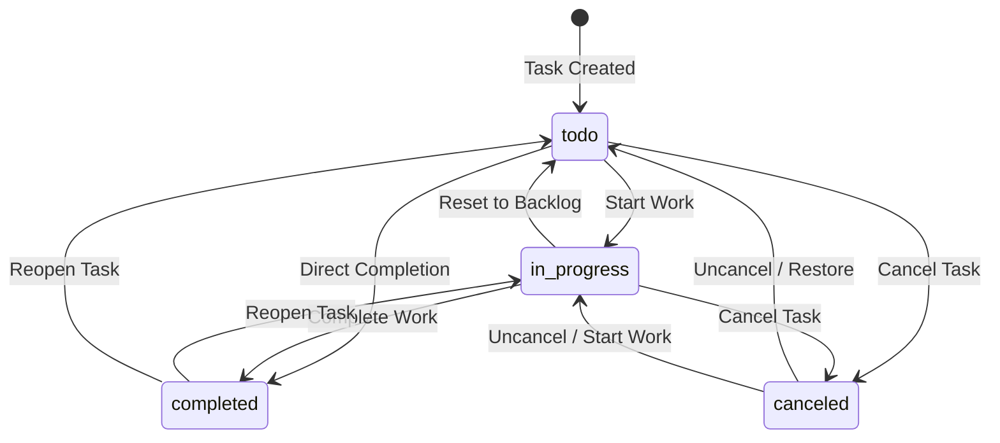

# Next.js Application Data Contract

**Project:** Modern Todo List Web Application  
**Target Platform:** Next.js (App Router / TypeScript) & Supabase  
**Document Status:** Implementation Ready  

---

## 1. Canonical TypeScript Definitions

These types represent the canonical contract between the database schema and the Next.js TypeScript application.

```typescript
// ==========================================
// Enum Types
// ==========================================

export type TaskStatus = 'todo' | 'in_progress' | 'completed' | 'canceled';

export type TaskPriority = 'low' | 'medium' | 'high' | 'urgent';

// ==========================================
// Base Entity Models
// ==========================================

export interface Project {
  id: string; // UUID
  user_id: string; // UUID
  name: string; // non-empty string
  description: string | null;
  color: string | null; // hex format e.g. #3B82F6
  is_archived: boolean;
  created_at: string; // ISO 8601 TIMESTAMPTZ
  updated_at: string; // ISO 8601 TIMESTAMPTZ
}

export interface Task {
  id: string; // UUID
  user_id: string; // UUID
  project_id: string | null; // null represents Inbox
  parent_id: string | null; // null represents Root Task
  title: string; // non-empty string
  description: string | null;
  status: TaskStatus;
  priority: TaskPriority;
  due_date: string | null; // ISO 8601 TIMESTAMPTZ
  completed_at: string | null; // ISO 8601 TIMESTAMPTZ
  sort_order: number; // integer
  depth: number; // 0 to 5
  created_at: string; // ISO 8601 TIMESTAMPTZ
  updated_at: string; // ISO 8601 TIMESTAMPTZ
}

export interface TaskChecklistItem {
  id: string; // UUID
  user_id: string; // UUID
  task_id: string; // UUID
  title: string; // non-empty string
  is_completed: boolean;
  position: number; // integer
  created_at: string; // ISO 8601 TIMESTAMPTZ
  updated_at: string; // ISO 8601 TIMESTAMPTZ
}

// ==========================================
// View Model: tasks_with_progress
// ==========================================

export interface TaskWithProgress extends Task {
  total_children_count: number;
  active_children_count: number;
  completed_children_count: number;
  total_checklist_count: number;
  completed_checklist_count: number;
  is_leaf: boolean;
  progress_percentage: number; // numeric e.g. 75.00
}
```

---

## 2. Status Lifecycle & State Transitions



### Transition Invariants
1. **Completion Timestamp (`completed_at`):**
   * Transitioning to `'completed'` automatically sets `completed_at` to `now()` via trigger if not supplied explicitly.
   * Transitioning away from `'completed'` resets `completed_at` to `NULL`.
2. **Subtask Status vs Parent Progress:**
   * Completing a subtask does not forcefully flip parent status to `'completed'` unless all active subtasks are complete. The view `tasks_with_progress` exposes `progress_percentage = 100.00` and `active_children_count = completed_children_count`.
   * Canceled subtasks do not penalize parent progress.

---

## 3. Progress Calculation Contract

The application should read progress directly from the `tasks_with_progress` view rather than computing rollups manually on the client.

### Resolution Summary
| Hierarchy / State Scenario | Authoritative Progress Result |
| :--- | :--- |
| **Branch Task ($N_{\text{total}} > 0, N_{\text{active}} > 0$)** | `ROUND((completed_children / active_children) * 100, 2)` |
| **Branch Task ($N_{\text{total}} > 0, N_{\text{active}} = 0$)** (all subtasks canceled) | `100.00` if parent status is `'completed'`, else `0.00` |
| **Leaf Task with Checklist ($N_{\text{total}} = 0, \text{items} > 0$)** | `ROUND((completed_checklists / total_checklists) * 100, 2)` |
| **Simple Leaf Task ($N_{\text{total}} = 0, \text{items} = 0$)** | `'completed'` $\to 100.00$, `'in_progress'` $\to 50.00$, else $0.00$ |

---

## 4. Next.js Mutation & Query Patterns

### 4.1 Fetching Projects
```typescript
// Server Action / Route Handler
const { data: projects, error } = await supabase
  .from('projects')
  .select('*')
  .eq('user_id', user.id)
  .eq('is_archived', false)
  .order('created_at', { ascending: false });
```

### 4.2 Fetching Root Tasks with Progress for a Project
```typescript
const { data: tasks, error } = await supabase
  .from('tasks_with_progress')
  .select('*')
  .eq('user_id', user.id)
  .eq('project_id', projectId)
  .is('parent_id', null)
  .order('sort_order', { ascending: true });
```

### 4.3 Fetching Subtasks for an Expanded Parent
```typescript
const { data: subtasks, error } = await supabase
  .from('tasks_with_progress')
  .select('*')
  .eq('user_id', user.id)
  .eq('parent_id', parentId)
  .order('sort_order', { ascending: true });
```

### 4.4 Fetching Checklist Items for a Task
```typescript
const { data: items, error } = await supabase
  .from('task_checklist_items')
  .select('*')
  .eq('user_id', user.id)
  .eq('task_id', taskId)
  .order('position', { ascending: true });
```

### 4.5 Creating a Root Task
```typescript
const { data: task, error } = await supabase
  .from('tasks')
  .insert({
    user_id: user.id,
    project_id: projectId ?? null,
    parent_id: null,
    title: 'Design database schema',
    description: 'Prepare PostgreSQL migrations',
    priority: 'high',
    status: 'in_progress',
    sort_order: nextSortOrder,
  })
  .select()
  .single();
```

### 4.6 Creating a Subtask (Automatic Depth & Project Synchronization)
```typescript
// Subtask inherits project_id and depth automatically via DB trigger
const { data: subtask, error } = await supabase
  .from('tasks')
  .insert({
    user_id: user.id,
    parent_id: parentTaskId,
    title: 'Write RLS migration',
    priority: 'medium',
    status: 'todo',
    sort_order: nextSortOrder,
  })
  .select()
  .single();
```

### 4.7 Reordering Subtasks (Drag-and-Drop)
```typescript
// Batch update sort orders
const updates = items.map((item, index) => ({
  id: item.id,
  user_id: user.id,
  sort_order: index * 10,
}));

const { error } = await supabase
  .from('tasks')
  .upsert(updates, { onConflict: 'id' });
```

### 4.8 Reparenting a Task
```typescript
// Moving a task under a new parent or to root
const { error } = await supabase
  .from('tasks')
  .update({ parent_id: newParentId }) // trigger validates cycles and recalculates depth
  .eq('id', taskId);
```

---

## 5. Database Exceptions & Client Error Mapping

| PostgreSQL Error Code | Cause | Client Error Handling Strategy |
| :--- | :--- | :--- |
| `23514` (`check_violation`) | `Circular task hierarchy detected` | Display error: "Cannot move task inside itself or one of its subtasks." |
| `23514` (`check_violation`) | `Maximum task nesting depth (5) exceeded` | Display error: "Maximum nesting level of 5 subtasks reached." |
| `23503` (`foreign_key_violation`) | Parent task or project does not exist / cross-tenant attempt | Display error: "Selected project or parent task not found." |
| `23514` (`check_violation`) | `projects_name_not_empty` or `tasks_title_not_empty` | Form validation: "Title is required and cannot be blank." |
