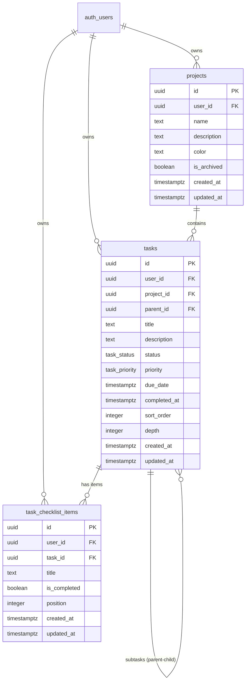

# Database Design Specification

**Project:** Modern Todo List Web Application  
**Target Platform:** Next.js & Supabase (PostgreSQL 15+)  
**Architect:** Senior Database Architect & Supabase Specialist  
**Status:** Implementation Ready (Planning & Artifact Phase)  

---

## 1. Executive Summary & Design Principles

This document defines the production database architecture for a modern, responsive Todo List web application built on Supabase PostgreSQL.

### Core Architectural Principles
1. **Strict Multi-Tenant Isolation:** Complete isolation at both the declarative foreign key constraint level and Row Level Security (RLS) policy level. No task, project, or checklist item can ever cross user boundaries.
2. **Defensive Relational Integrity:** Enforce data validity inside PostgreSQL through composite foreign keys, CHECK constraints, and cycle-detecting triggers, ensuring data integrity regardless of client bugs or direct API mutations.
3. **Deterministic, Normalized Progress Calculation:** Eliminate desynchronization, concurrency locks, and trigger overhead by computing parent-task progress deterministically at query time via a dedicated `security_invoker` view and canonical calculation function.
4. **Lean and Extensible:** Provide complete functionality for projects, hierarchical tasks, subtask reorganization, and optional checklist items without introducing speculative abstraction layers.

---

## 2. Requirements & Assumption Analysis

### 2.1 Confirmed Requirements
* **Authentication & Ownership:** Managed via Supabase Auth (`auth.users`). Every top-level entity is strictly owned by a single user.
* **Projects:** Container entity for organizing tasks with custom names, optional descriptions, colors, and archive status.
* **Hierarchical Tasks:** Tasks support parent-child nesting, titles, rich descriptions, statuses, priorities, due dates, sorting positions, and timestamps.
* **Subtask Reorganization:** Support for adding, reordering, reparenting, and completing subtasks.
* **Parent Progress Calculation:** Automatic derivation of parent progress based on direct child completion status.
* **Checklist Items:** Lightweight inline checkboxes attached to tasks for micro-steps that do not require full subtask attributes.
* **Multi-User Security:** Supabase RLS enforces data boundaries using `auth.uid()`.

### 2.2 Documented Assumptions & Design Decisions
| Decision Area | Selected Strategy | Rationale |
| :--- | :--- | :--- |
| **Standalone Tasks** | `tasks.project_id` is nullable. | Allows users to create tasks in an unassigned "Inbox" without forcing the creation of a default project. |
| **Nesting Depth Limit** | Capped at depth = 5 (`CHECK (depth >= 0 AND depth <= 5)`). | Prevents unbounded recursion, UI stack overflow, and query performance degradation while accommodating real-world nesting workflows. |
| **Subtask Project Scope** | Subtasks inherit and strictly match their parent's `project_id`. | Prevents incoherent states where a subtask belongs to "Project B" while its parent belongs to "Project A". Enforced automatically via hierarchy trigger. |
| **Cross-Tenant Constraint Guarantee** | Composite Unique Keys `(id, user_id)` and Composite Foreign Keys `(parent_id, user_id)` and `(project_id, user_id)`. | PostgreSQL standard foreign keys ignore RLS. Composite foreign keys guarantee at the storage engine level that a user can never reference another user's project or task. |
| **Progress Persistence vs Derivation** | Derived at query time via `tasks_with_progress` view and canonical function. | Denormalized stored progress columns suffer from trigger race conditions, deadlocks during bulk edits, and desynchronization. A view with indexed child aggregation is sub-millisecond and 100% consistent. |
| **Canceled Tasks in Progress** | Excluded from the progress denominator. | When a subtask is canceled, it represents abandoned work. Counting it against the parent permanently caps progress below 100%; excluding it reflects active progress accurately. |

---

## 3. Entity-Relationship Model



### Cardinality Summary
* `auth.users` $\to$ `projects`: 1 to $N$ (one user can own zero or many projects).
* `auth.users` $\to$ `tasks`: 1 to $N$ (one user can own zero or many tasks).
* `projects` $\to$ `tasks`: 1 to $N$ (optional parent: task can belong to 0 or 1 project).
* `tasks` $\to$ `tasks`: 1 to $N$ (recursive self-reference: parent task can have 0 to many subtasks).
* `tasks` $\to$ `task_checklist_items`: 1 to $N$ (one task can have 0 to many checklist items).

---

## 4. Schema Specification

### 4.1 Custom Enumerated Types

#### `task_status`
```sql
CREATE TYPE task_status AS ENUM (
    'todo',
    'in_progress',
    'completed',
    'canceled'
);
```

#### `task_priority`
```sql
CREATE TYPE task_priority AS ENUM (
    'low',
    'medium',
    'high',
    'urgent'
);
```

---

### 4.2 Table: `projects`
Stores task collection containers owned by individual users.

| Column | Type | Nullable | Default | Constraints & References | Description |
| :--- | :--- | :--- | :--- | :--- | :--- |
| `id` | `UUID` | No | `gen_random_uuid()` | `PRIMARY KEY` | Unique project identifier |
| `user_id` | `UUID` | No | `auth.uid()` | `REFERENCES auth.users(id) ON DELETE CASCADE` | Owner user identifier |
| `name` | `TEXT` | No | None | `CHECK (char_length(trim(name)) > 0)` | Name of the project (non-empty) |
| `description` | `TEXT` | Yes | `NULL` | None | Markdown/plain text description |
| `color` | `TEXT` | Yes | `NULL` | `CHECK (color IS NULL OR color ~* '^#[0-9a-f]{6}$')` | Optional hex color code (e.g. `#3B82F6`) |
| `is_archived` | `BOOLEAN` | No | `FALSE` | None | Soft-archival flag |
| `created_at` | `TIMESTAMPTZ`| No | `now()` | None | Record creation timestamp |
| `updated_at` | `TIMESTAMPTZ`| No | `now()` | None | Record update timestamp |

**Additional Constraints & Triggers:**
* `projects_id_user_id_key UNIQUE (id, user_id)`: Enables composite foreign key enforcement from `tasks`.
* `trg_projects_prevent_user_id_change`: Prohibits modifying `user_id` on update.
* `trg_projects_enforce_user_id`: Automatically sets `user_id := auth.uid()` when missing on insert.

---

### 4.3 Table: `tasks`
Stores root tasks and hierarchical subtasks.

| Column | Type | Nullable | Default | Constraints & References | Description |
| :--- | :--- | :--- | :--- | :--- | :--- |
| `id` | `UUID` | No | `gen_random_uuid()` | `PRIMARY KEY` | Unique task identifier |
| `user_id` | `UUID` | No | `auth.uid()` | `REFERENCES auth.users(id) ON DELETE CASCADE` | Owner user identifier |
| `project_id` | `UUID` | Yes | `NULL` | Composite FK to `projects(id, user_id)` | Container project (NULL = Inbox) |
| `parent_id` | `UUID` | Yes | `NULL` | Composite FK to `tasks(id, user_id)` | Parent task (NULL = Root task) |
| `title` | `TEXT` | No | None | `CHECK (char_length(trim(title)) > 0)` | Task title (non-empty) |
| `description` | `TEXT` | Yes | `NULL` | None | Extended notes or description |
| `status` | `task_status`| No | `'todo'` | Valid enum value | Current workflow status |
| `priority` | `task_priority`| No | `'medium'`| Valid enum value | Priority level |
| `due_date` | `TIMESTAMPTZ`| Yes | `NULL` | None | Target deadline with timezone |
| `completed_at` | `TIMESTAMPTZ`| Yes | `NULL` | None | Timestamp when status became `'completed'` |
| `sort_order` | `INTEGER` | No | `0` | None | Ordering index within parent/project list |
| `depth` | `INTEGER` | No | `0` | `CHECK (depth >= 0 AND depth <= 5)` | Hierarchy depth (0 = root) |
| `created_at` | `TIMESTAMPTZ`| No | `now()` | None | Record creation timestamp |
| `updated_at` | `TIMESTAMPTZ`| No | `now()` | None | Record update timestamp |

**Integrity Constraints & Triggers:**
* `tasks_id_user_id_key UNIQUE (id, user_id)`: Composite key supporting subtask and checklist composite FKs.
* `tasks_no_self_parent CHECK (parent_id IS NULL OR parent_id <> id)`: Guard against immediate self-referencing.
* `tasks_project_fkey FOREIGN KEY (project_id, user_id) REFERENCES projects(id, user_id) ON DELETE CASCADE`: Guarantees task cannot reference a project owned by another user.
* `tasks_parent_fkey FOREIGN KEY (parent_id, user_id) REFERENCES tasks(id, user_id) ON DELETE CASCADE`: Guarantees task cannot reference a parent owned by another user.
* `trg_tasks_prevent_user_id_change`: Prohibits modifying `user_id` on update.
* `trg_tasks_enforce_user_id`: Automatically sets `user_id := auth.uid()` when missing on insert.
* `trg_cascade_descendant_project`: Propagates `project_id` changes to subtasks when parent task moves project.

---

### 4.4 Table: `task_checklist_items`
Stores optional lightweight checklist items attached to any task.

| Column | Type | Nullable | Default | Constraints & References | Description |
| :--- | :--- | :--- | :--- | :--- | :--- |
| `id` | `UUID` | No | `gen_random_uuid()` | `PRIMARY KEY` | Unique checklist item ID |
| `user_id` | `UUID` | No | `auth.uid()` | `REFERENCES auth.users(id) ON DELETE CASCADE` | Owner user identifier |
| `task_id` | `UUID` | No | None | Composite FK to `tasks(id, user_id)` | Parent task identifier |
| `title` | `TEXT` | No | None | `CHECK (char_length(trim(title)) > 0)` | Checklist item text |
| `is_completed`| `BOOLEAN` | No | `FALSE` | None | Completion status |
| `position` | `INTEGER` | No | `0` | None | Display position order |
| `created_at` | `TIMESTAMPTZ`| No | `now()` | None | Record creation timestamp |
| `updated_at` | `TIMESTAMPTZ`| No | `now()` | None | Record update timestamp |

**Integrity Constraints & Triggers:**
* `checklist_task_fkey FOREIGN KEY (task_id, user_id) REFERENCES tasks(id, user_id) ON DELETE CASCADE`: Guarantees checklist item cannot be attached to another user's task.
* `trg_checklist_prevent_user_id_change`: Prohibits modifying `user_id` on update.
* `trg_checklist_enforce_user_id`: Automatically sets `user_id := auth.uid()` when missing on insert.

---

## 5. Task Hierarchy & Integrity Rules

### 5.1 Cycle Prevention & Depth Validation
A database trigger `trg_validate_task_hierarchy` fires `BEFORE INSERT OR UPDATE OF parent_id, project_id ON tasks`:
1. **Self-Parent Check:** If `parent_id = id`, raises exception.
2. **Cycle Traversal:** Climbs the ancestor chain up to root. If the task's own ID appears in the ancestor chain, raises an exception `Circular task hierarchy detected`.
3. **Depth Calculation & Enforcement:** Accurately computes `depth = parent.depth + 1`. If `depth > 5`, raises `Maximum task nesting depth (5) exceeded`.
4. **Project Coherence:** Ensures `child.project_id = parent.project_id`. If `project_id` differs, it is synchronized automatically to the parent's project ID.

### 5.2 Descendant Depth Cascade
When an existing task is moved under a new parent, an `AFTER UPDATE OF depth ON tasks` trigger cascades depth adjustments down to direct child tasks, ensuring all descendant `depth` values remain accurate without requiring client-side recalculations.

---

## 6. Progress Calculation Specification

### 6.1 Authoritative Mathematical Contract

Let task $T$ have:
* Direct child tasks $C = \{c_1, c_2, \dots, c_n\}$
* Direct checklist items $K = \{k_1, k_2, \dots, k_m\}$

We partition direct children by status:
* $N_{\text{total}} = |C|$
* $N_{\text{active}} = |\{c \in C \mid c.\text{status} \in (\text{'todo'}, \text{'in\_progress'}, \text{'completed'}\}|$
* $N_{\text{completed}} = |\{c \in C \mid c.\text{status} = \text{'completed'}\}|$
* $N_{\text{canceled}} = |\{c \in C \mid c.\text{status} = \text{'canceled'}\}|$

#### Progress Resolution Rules:
1. **Branch Task ($N_{\text{total}} > 0$):**
   * If $N_{\text{active}} > 0$:
     $$\text{Progress}(T) = \text{ROUND}\left( \frac{N_{\text{completed}}}{N_{\text{active}}} \times 100.00, 2 \right)$$
   * If $N_{\text{active}} = 0$ (all children are canceled):
     * If $T.\text{status} = \text{'completed'}$, $\text{Progress}(T) = 100.00$
     * Else, $\text{Progress}(T) = 0.00$
2. **Leaf Task with Checklist Items ($N_{\text{total}} = 0 \land m > 0$):**
   $$\text{Progress}(T) = \text{ROUND}\left( \frac{|\{k \in K \mid k.\text{is\_completed} = \text{true}\}|}{m} \times 100.00, 2 \right)$$
3. **Simple Leaf Task ($N_{\text{total}} = 0 \land m = 0$):**
   * If $T.\text{status} = \text{'completed'}$, $\text{Progress}(T) = 100.00$
   * If $T.\text{status} = \text{'in\_progress'}$, $\text{Progress}(T) = 50.00$
   * If $T.\text{status} \in (\text{'todo'}, \text{'canceled'}$, $\text{Progress}(T) = 0.00$

### 6.2 Implementation via `tasks_with_progress` View
Rather than maintaining derived progress values in stored columns—which introduces lock contention, trigger storms, and desynchronization—the schema provides the `tasks_with_progress` view with `WITH (security_invoker = true)`:
```sql
SELECT
    t.*,
    p.progress_percentage,
    p.total_children_count,
    p.active_children_count,
    p.completed_children_count,
    p.checklist_total_count,
    p.checklist_completed_count
FROM tasks t
LEFT JOIN LATERAL (...) p ON TRUE;
```
This guarantees real-time mathematical precision with zero background write overhead.

---

## 7. Deletion & Lifecycle Cascades

* **User Deletion (`auth.users`):** Deleting a user triggers `CASCADE` across all owned `projects`, `tasks`, and `task_checklist_items`, leaving zero orphaned rows.
* **Project Deletion (`projects`):** Deleting a project triggers `CASCADE` across all assigned tasks (`project_id`), which subsequently cascades down all nested subtasks and checklist items.
* **Parent Task Deletion (`tasks`):** Deleting a parent task triggers `CASCADE` across all direct and indirect subtasks and attached checklist items.
* **Status Updates (`completed_at`):** Trigger `trg_handle_task_completed_at` automatically populates `completed_at = now()` when transitioning to `'completed'`, and clears `completed_at = NULL` if reopened.

---

## 8. Indexing Strategy & Query Workloads

| Workload / Query Pattern | Target Index | Type | Purpose |
| :--- | :--- | :--- | :--- |
| **User Projects List** | `projects(user_id, is_archived)` | B-Tree | Rapid filtering of active projects by user |
| **Project Root Tasks** | `tasks(user_id, project_id, parent_id, sort_order)` | B-Tree | Instant fetch of top-level project tasks |
| **Inbox Tasks** | `tasks(user_id, sort_order) WHERE project_id IS NULL AND parent_id IS NULL` | B-Tree Partial | Quick access to unassigned inbox items |
| **Child Tasks / Subtasks** | `tasks(user_id, parent_id, sort_order)` | B-Tree | Hierarchical navigation and progress aggregation |
| **Pending & Due Tasks** | `tasks(user_id, due_date) WHERE status NOT IN ('completed', 'canceled')` | B-Tree Partial | Dashboard "Today" / "Upcoming" / overdue queries |
| **Checklist Item Listing** | `task_checklist_items(user_id, task_id, position)` | B-Tree | Fetch checklist items in display order |
